# Smart Energy Consumption Analytics & Forecasting

[](LICENSE)
[](https://www.python.org/)
[](https://spark.apache.org/)
[](https://hadoop.apache.org/)
[](https://sdgs.un.org/goals/goal7)

---

## Project Team

| Student Name | Roll Number | Batch |
|---|---|---|
| **Vaibhav** | **AP23110010425** | **Batch 30** |
| **Saubhagya Kashyap** | **AP23110010439** | **Batch 30** |

- **Course**: Big Data
- **Target Sustainable Development Goal**: **UN SDG 7 — Affordable and Clean Energy**


## Run it on a Mac

```bash
bash run_on_mac.sh            # install everything, start Hadoop, run the whole pipeline
bash run_on_mac.sh dashboard  # open the Streamlit dashboard
bash run_on_mac.sh stop       # stop Hadoop
```

---

## 1. Project Overview

**Smart Energy Consumption Analytics & Forecasting** is a Big Data analytics and machine learning course project. It processes over **2.075 million high-frequency electrical smart meter records** spanning 47 continuous months (December 2006 – November 2010).

The system integrates:
1. **Physical Preprocessing & Unit Conversions**: Translates instantaneous active power (kW) into interval energy (kWh), normalizes sub-metering Watt-hours, tracks daily completeness, and eliminates sensor noise without synthetic interpolation.
2. **Distributed Storage (HDFS)**: A single-node Hadoop cluster holds the raw file, the cleaned tables, the feature table, the MapReduce outputs and the Hive warehouse under `/smart-energy`.
3. **Batch Aggregation (Hadoop MapReduce on YARN)**: Two Hadoop Streaming jobs over the full dataset: daily energy totals (matching the pipeline's table within 0.0001 kWh on all 1,433 days) and the hour-of-day load profile.
4. **Data Warehouse (Apache Hive)**: Hive 4.0.1 with HiveServer2; ORC and Parquet tables loaded from HDFS; 12 HiveQL queries run as MapReduce jobs on YARN and cross-checked in Spark SQL, assessing diurnal variation, peak demand hours, weekday vs. weekend patterns, seasonal trends, and sub-metering distributions.
5. **Causal Time-Series Feature Engineering (Apache Spark)**: PySpark SQL Windowing generating 15 historical lags and preceding rolling statistics strictly isolated from forward data leakage.
6. **Supervised Next-Day Forecasting (Apache Spark MLlib)**: Non-shuffled chronological evaluation comparing a Naive Persistence Baseline against ElasticNet Linear Regression and Random Forest Regression.
7. **Interactive Decision Support (Streamlit & Matplotlib)**: A six-page Streamlit dashboard, four report figures and star-schema CSV exports supporting UN SDG 7 demand-side load shifting and peak shaving.

---

## 2. Problem Statement

Modern electrical smart meters generate continuous high-frequency telemetry at 1-minute intervals. However, utility providers and residential consumers face critical operational hurdles:
- **Massive Ingestion Volume**: Raw telemetry exceeds millions of records, overwhelming traditional relational databases.
- **Data Quality & Physical Units**: Instantaneous power (kW) is often conflated with energy (kWh), and missing readings (`?`) distort consumption baselines if filled naively.
- **Pervasive Data Leakage**: Conventional time-series ML pipelines erroneously shuffle chronological observations, producing artificially inflated, non-generalizable forecasting models.
- **Lack of Actionable Conservation Insights**: Raw smart meter telemetry fails to pinpoint peak demand hours or quantify the cost and carbon benefits of load shifting.

---

## 3. Sustainable Development Goal (SDG 7 Alignment)

This project directly advances **UN Sustainable Development Goal 7: Affordable and Clean Energy (Level 3 Impact)**:
- **Target 7.3 (Double the global rate of improvement in energy efficiency)**: By analyzing diurnal consumption curves, the project identifies an intensive residential peak between **18:00 and 21:00** (averaging 1.71 kW) and an off-peak nocturnal valley between **01:00 and 05:00** (averaging 0.47 kW).
- **Demand-Side Peak Shaving**: Shifting 15% of discretionary appliance load (dishwashing, laundry, water heating) to nocturnal off-peak hours flattens the household's load curve. How much a household saves depends on its time-of-use tariff; this dataset has no tariff data, so no saving is quantified.
- **Statistical Anomaly Waste Detection**: Automated flagging of anomalous consumption days ($> \mu + 2\sigma = 46.2 \text{ kWh}$) alerts consumers to malfunctioning appliances, insulation degradation, or parasitic phantom loads.

---

## 4. Dataset Overview

- **Source**: UCI Machine Learning Repository — *Individual Household Electric Power Consumption*.
- **Attribution**: Georges Hébrail, Alice Bérard (EDF R&D).
- **Temporal Horizon**: December 16, 2006 (17:24) to November 26, 2010 (21:02) — 47 continuous months.
- **Sampling Frequency**: 1 measurement per minute.
- **Total Records Processed**: **2,075,259 observations**.
- **Schema**:
  1. `Date`: String format `DD/MM/YYYY`.
  2. `Time`: String format `HH:MM:SS`.
  3. `Global_active_power`: Household minute-averaged active power (kW).
  4. `Global_reactive_power`: Household minute-averaged reactive power (kW).
  5. `Voltage`: Minute-averaged voltage (V).
  6. `Global_intensity`: Current intensity (A).
  7. `Sub_metering_1`: Active energy for kitchen appliances (dishwasher, microwave, oven) in Watt-hours.
  8. `Sub_metering_2`: Active energy for laundry room (washing machine, dryer, refrigerator) in Watt-hours.
  9. `Sub_metering_3`: Active energy for climate control and water heater in Watt-hours.

---

## 5. Technology Stack & Big Data Roles

| Technology | Role & Implementation in Project |
|---|---|
| **Python 3.11+** | Core programming language for data engineering, automation scripts, and unit testing. |
| **Apache Hadoop 3.3.6 (HDFS, YARN)** | Single-node cluster storing the raw file, cleaned tables, features and Hive warehouse. |
| **Hadoop MapReduce** | Two Hadoop Streaming jobs on YARN: daily energy totals and hour-of-day load profile. |
| **Apache Hive 4.0.1** | HiveServer2 with ORC and Parquet tables; 12 HiveQL queries executed as MapReduce jobs on YARN. |
| **Apache Spark 3.5.3 (PySpark, Spark SQL)** | Reads the cleaned tables from HDFS; window-function feature pipeline; SQL cross-check of the Hive results. |
| **Spark MLlib** | Distributed machine learning estimators (`LinearRegression`, `RandomForestRegressor`, `VectorAssembler`). |
| **Streamlit & Plotly** | Six-page interactive dashboard (`app.py`). |
| **Dashboard export tables** | Five star-schema CSV tables that can be loaded into Power BI or Tableau. |
| **Matplotlib & Seaborn** | Publication-quality preview figure generation and empirical evaluation charts. |
| **Pytest** | Automated unit testing framework (35 test cases). |

---

## 6. System Architecture

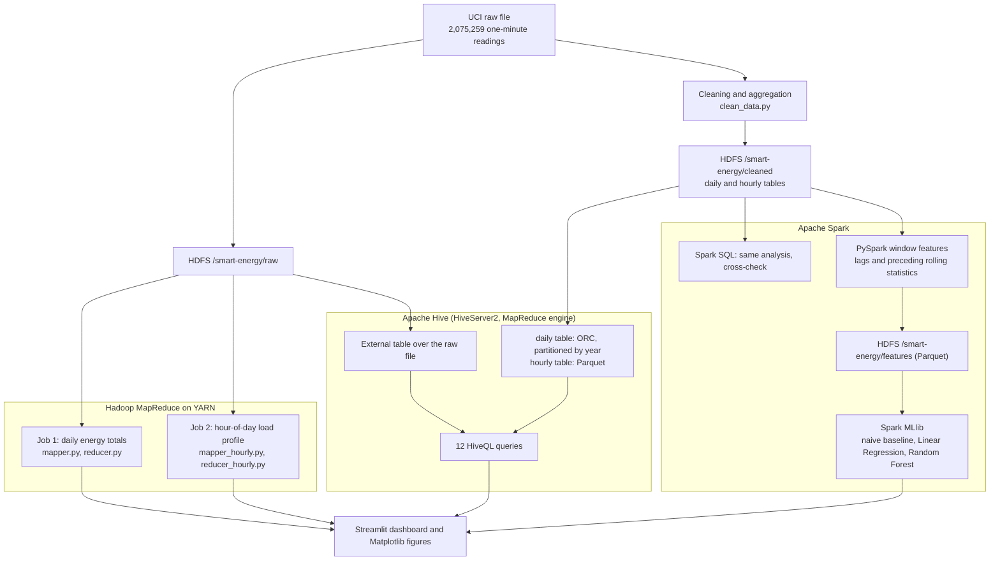

---

## 7. Implementation Status & Feature Verification

| Component | Status | Implementation Details |
|---|---|---|
| **Raw Dataset Ingestion** | **PASS** | 2,075,259 records inspected; 25,979 missing (`?`) rows flagged; 0 duplicate timestamps. |
| **Preprocessing & Normalization** | **PASS** | Physical unit conversions ($P \times 1/60$ for kW to kWh, $/1000$ for Wh to kWh); completeness tracking. |
| **HDFS Storage** | **PASS** | Single-node cluster; raw file (126.8 MB), cleaned tables, features and Hive warehouse stored under `/smart-energy`. |
| **Hadoop MapReduce** | **PASS** | Two Streaming jobs run on YARN over 2,075,259 rows; daily totals match the pipeline table within 0.0001 kWh. |
| **Apache Hive** | **PASS** | 12 queries executed on HiveServer2 (MapReduce engine on YARN); results in `hive/cluster_results/`. |
| **Spark SQL cross-check** | **PASS** | 11 of the queries re-run in Spark SQL from HDFS; results in `hive/query_results/`. |
| **PySpark Feature Engineering** | **PASS** | Reads from HDFS; causal backwards windowing; 15 lag and rolling features generated; 1,413 complete rows. |
| **Machine Learning Forecasting** | **PASS** | Spark MLlib Naive Baseline, Linear Regression, and Random Forest trained and evaluated chronologically. |
| **Power BI Dashboard Exports** | **PASS** | 5 clean Star-Schema CSV exports generated in `dashboard/power_bi_exports/`. |
| **Publication Visualizations** | **PASS** | 4 publication-quality figures rendered in `screenshots/` using actual data. |
| **Automated Testing Suite** | **PASS** | **35 / 35 pytest tests passing**. |

---

## 8. Empirical Machine Learning Forecasting Results

Models were evaluated on a **strict chronological held-out test period** (April 19, 2010 – November 26, 2010, $N = 213$ days) after parameter selection on a validation partition (September 2009 – April 2010):

| Model | Algorithm / Type | Test MAE (kWh) | Test RMSE (kWh) | Test $R^2$ Score | Test MAPE (%) | Validation RMSE |
|---|---|---|---|---|---|---|
| **Naive Baseline** | Persistence ($y_{t-1}$) | 4.4998 | 6.4155 | 0.2024 | 19.20% | 8.4182 |
| **Linear Regression** | Spark MLlib ElasticNet | 3.9607 | 5.3711 | 0.4409 | 18.21% | 6.2883 |
| **Random Forest Regressor** | Spark MLlib (40 trees, depth 5) | **3.8203** | **5.1588** | **0.4843** | **18.19%** | **6.1262** |

### Key Results Summary:
- **Best Model**: **Random Forest Regressor** achieved the lowest test RMSE (**5.1588 kWh**) and the highest $R^2$ (**0.4843**).
- **Baseline Improvement**: Random Forest reduced Test RMSE by **19.59%** and MAE by **15.10%** compared to the Naive Persistence baseline.
- **Physical Plausibility**: All predicted values were strictly positive and consistent with historical household distributions.

---

## 9. Screenshots of the Working Project

Taken on 15 Nov 2026 from the running single-node cluster and dashboard. All 17 are in [screenshots/demo/](screenshots/demo/).

### HDFS: project data in `/smart-energy`
Raw file, cleaned tables, features, MapReduce outputs and the Hive warehouse.

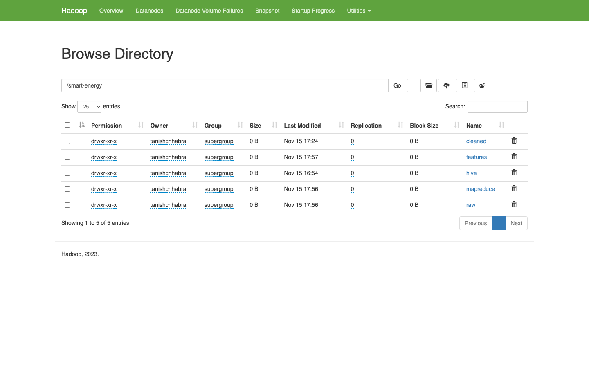

### HDFS: the full dataset (126.8 MB, 2,075,259 rows)

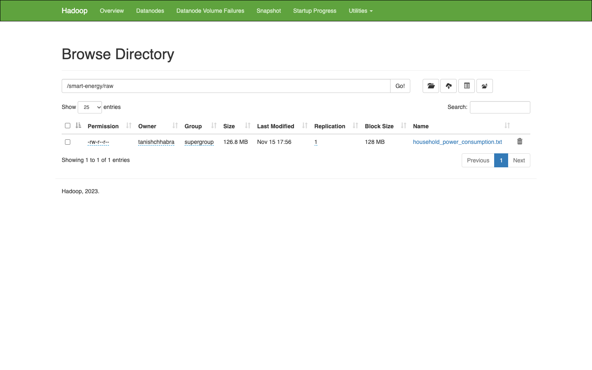

### YARN: MapReduce and Hive jobs, all succeeded

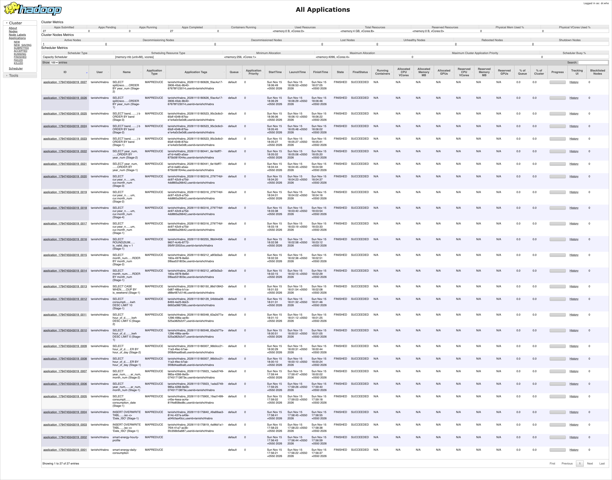

### Hive warehouse: daily table stored as ORC, partitioned by year

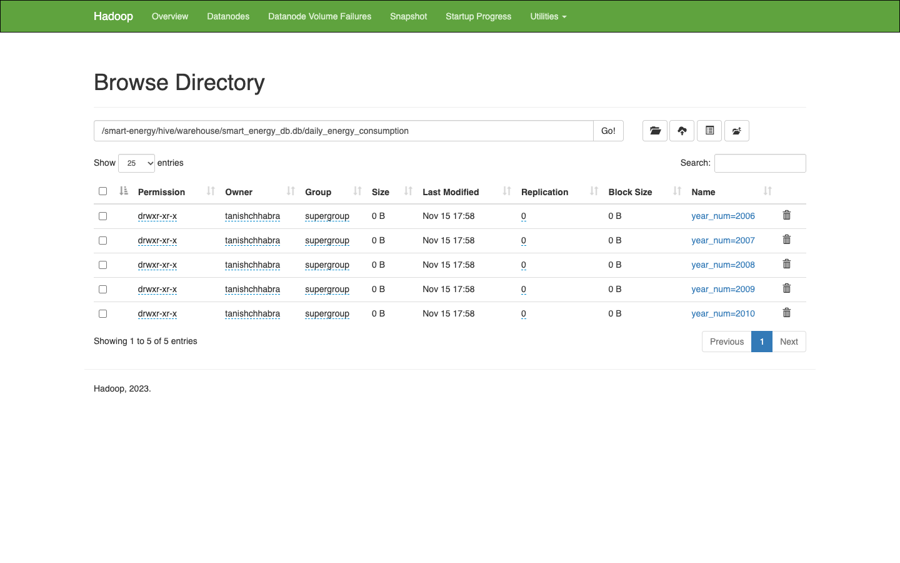

### HiveServer2

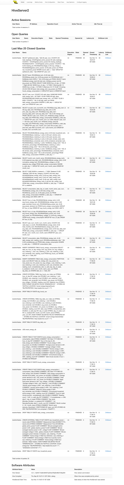

### Dashboard: energy overview

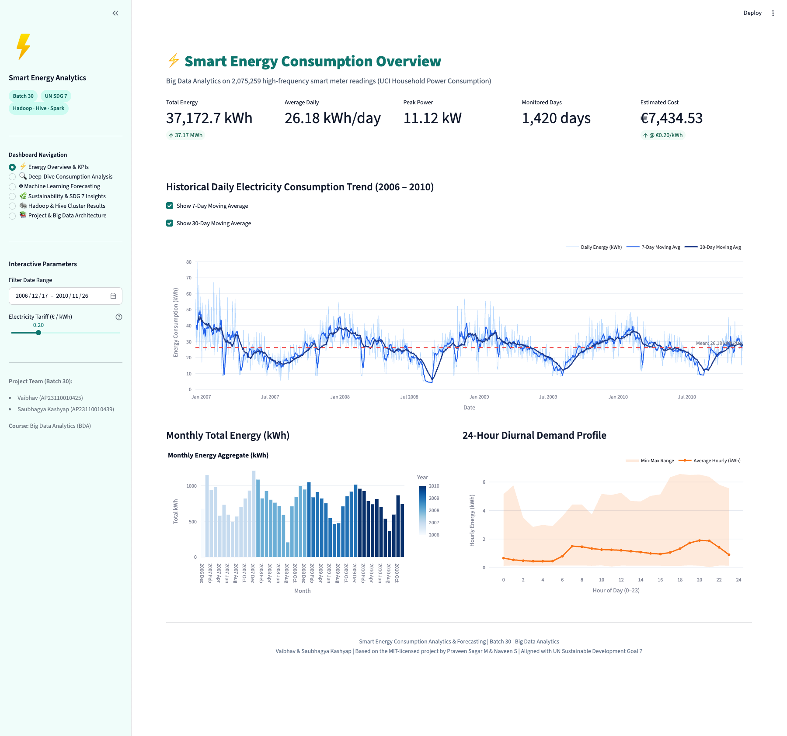

### Dashboard: forecasting with Spark MLlib

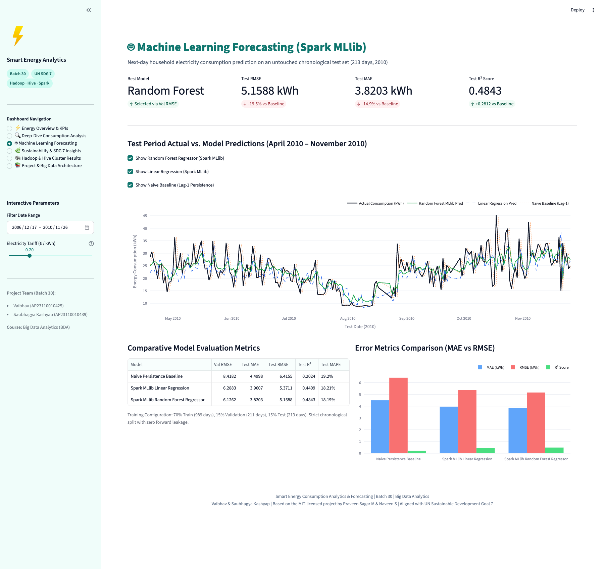

### Dashboard: Hadoop and Hive cluster results

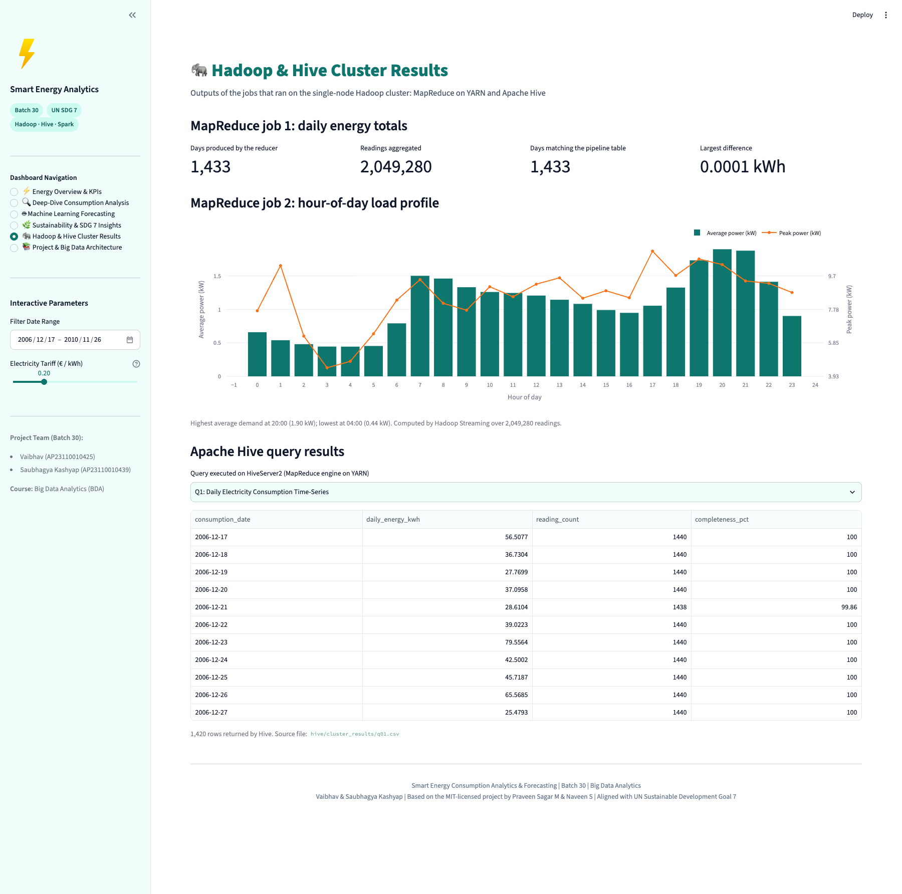

### Report figures (Matplotlib)

### Figure 1: Energy Overview Dashboard
Shows the 4-year daily electricity consumption trend with a 30-day moving average overlay, monthly aggregate energy bar chart, and the 24-hour diurnal demand cycle.
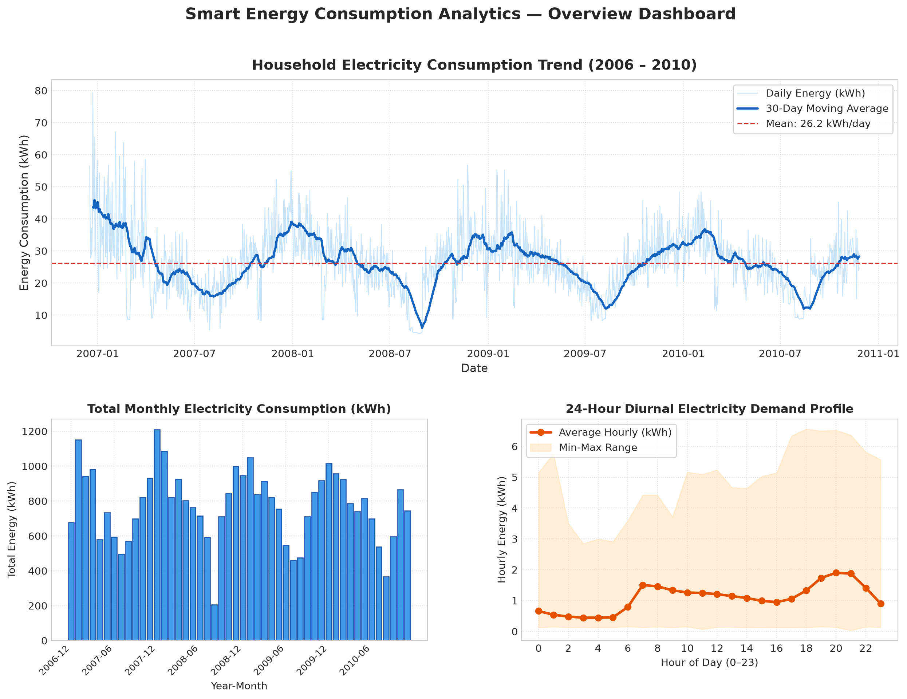

### Figure 2: Consumption Deep-Dive Analysis
Illustrates the weekday vs. weekend boxplot distribution (+19.1% on weekends), sub-metering end-use distribution (Climate/Water = 35.5%, Remainder = 51.2%), and diurnal demand curves broken down by day of week.
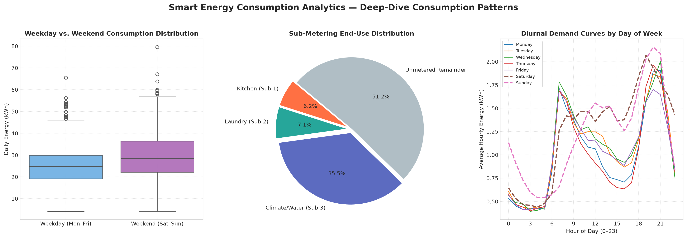

### Figure 3: Machine Learning Forecasting Results
Compares actual next-day energy against predictions from Random Forest, Linear Regression, and Naive Baseline across the held-out test set, along with comparative metric bar charts.
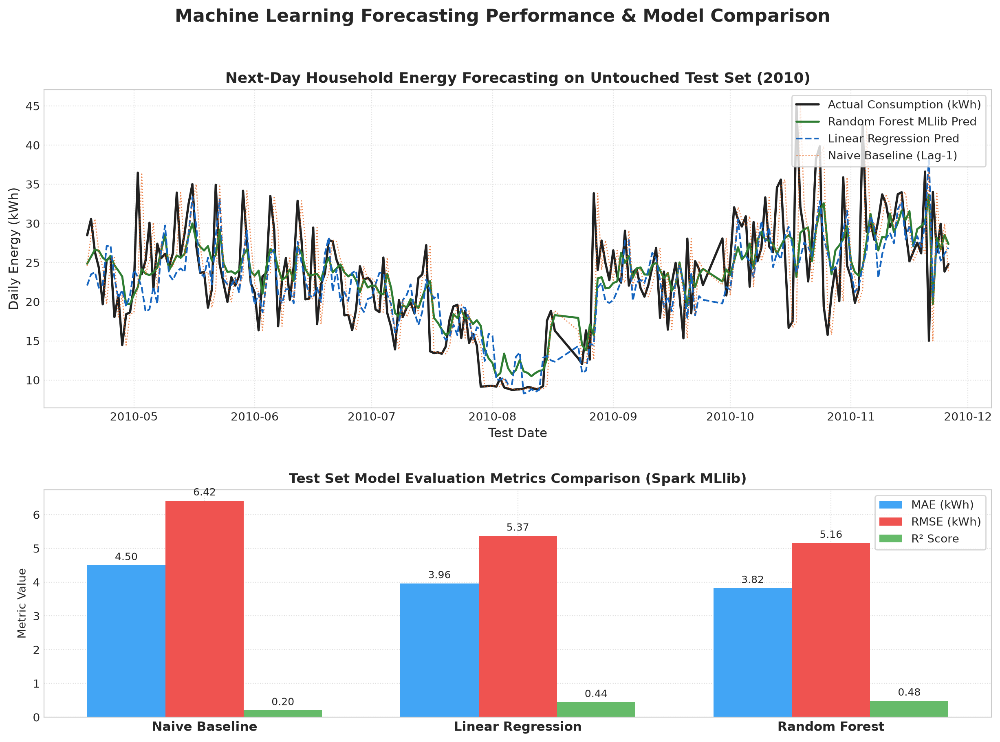

### Figure 4: Sustainability & SDG 7 Insights
Presents the statistical anomaly detection scatter plot (identifying 49 high-consumption days $> \mu + 2\sigma$) and the peak-shaving opportunity window (shifting loads from 18:00–21:00 to 01:00–05:00).
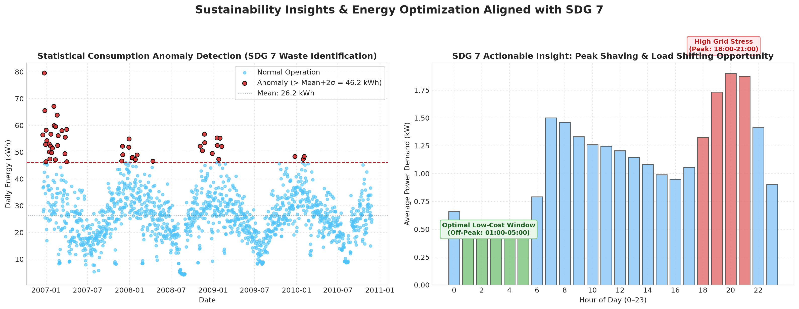

---

## 10. How to Run the Project

```bash
bash run_on_mac.sh            # install Java 11, Hadoop, Hive and the dataset; run everything
bash run_on_mac.sh status     # running daemons and HDFS contents
bash run_on_mac.sh hive       # run only the Hive stage again
bash run_on_mac.sh dashboard  # Streamlit dashboard at http://localhost:8501
bash run_on_mac.sh stop       # stop HiveServer2 and Hadoop
```

- Setup details and troubleshooting: [docs/installation.md](docs/installation.md)
- What each stage does and how to run it alone: [docs/execution.md](docs/execution.md)
- Feature list: [FEATURES.md](FEATURES.md)

---

## 11. Directory Structure

```
Smart-Energy-Analytics-Forecasting/
├── README.md                           # Main academic documentation & project portfolio
├── LICENSE                             # MIT Open Source License
├── requirements.txt                    # Python dependencies
├── .gitignore                          # Git exclusions for large datasets & caches
│
├── data/
│   ├── raw/                            # Raw data directory (126MB txt ignored by git)
│   │   ├── sample_household_power_consumption.txt # 5,000-row representative test sample
│   ├── processed/                      # Cleaned aggregate tables
│   │   ├── daily_energy_consumption.csv
│   │   ├── hourly_energy_consumption.csv
│   │   └── cleaning_summary.json
│   └── features/                       # Engineered feature matrix
│       └── daily_energy_features.csv
│
├── preprocessing/                      # Preprocessing & cleaning scripts
│   ├── clean_data.py                   # Chunked memory-conscious ingestion & unit conversion
│   └── missing_data_policy.md          # Scientific missing-data & quality policy
│
├── run_on_mac.sh                       # One-command setup and run for macOS (Hadoop, Hive, pipeline)
├── FEATURES.md                         # Everything the project contains
│
├── hadoop/                             # Hadoop MapReduce & HDFS modules
│   ├── mapper.py, reducer.py           # Job 1: daily energy totals
│   ├── mapper_hourly.py, reducer_hourly.py   # Job 2: hour-of-day load profile
│   ├── mapreduce_yarn_daily_output.txt       # Job 1 output from YARN (1,433 rows)
│   ├── mapreduce_yarn_hourly_output.txt      # Job 2 output from YARN (24 rows)
│   ├── mapreduce_yarn_*job_log.txt     # YARN job logs
│   ├── run_mapreduce.py                # Local mapper/reducer check on the sample
│   └── mapreduce_daily_output.txt      # Output of the local check
│
├── hive/                               # Apache Hive warehouse module
│   ├── schema.hql                      # Database, raw external table, ORC and Parquet tables
│   ├── load_cleaned_tables.hql         # Loads the cleaned tables from HDFS into the warehouse
│   ├── queries.hql                     # 12 HiveQL queries
│   ├── run_hive_on_cluster.py          # Runs all of the above on HiveServer2 through beeline
│   ├── cluster_results/                # q01.csv ... q12.csv returned by Hive
│   ├── hive_cluster_report.md          # Hive run report with timings
│   ├── run_hive_analytics.py           # Spark SQL cross-check (11 queries)
│   ├── query_results/                  # Spark SQL results
│   └── hive_execution_report.md        # Spark SQL run report
│
├── spark/                              # Apache Spark core module
│   └── spark_feature_pipeline.py       # PySpark backwards windowing feature engineering
│
├── forecasting/                        # Machine learning forecasting module
│   ├── train_models.py                 # Spark MLlib Baseline, Linear Regression, Random Forest
│   ├── test_predictions.csv            # Held-out test period actual vs predicted values
│   └── evaluation_metrics.json         # MAE, RMSE, R2, MAPE JSON metrics
│
├── dashboard/                          # Business Intelligence & Power BI module
│   ├── generate_dashboard_exports.py   # Star-Schema CSV export generator
│   ├── generate_plots.py               # Publication figure renderer (Matplotlib)
│   └── power_bi_exports/               # 5 Power BI import-ready Star-Schema CSV tables
│
├── screenshots/                        # Report figures; demo/ holds browser screenshots of HDFS, YARN, Hive and the dashboard
│   ├── 01_energy_overview.png
│   ├── 02_consumption_analysis.png
│   ├── 03_forecasting_results.png
│   └── 04_sustainability_insights.png
│
├── scripts/                            # Operational automation scripts
│   └── run_pipeline.py                 # End-to-end master pipeline runner
│
├── tests/                              # Pytest automated test suite (35 tests)
│   ├── test_preprocessing.py           # Unit conversions & parsing
│   ├── test_mapreduce.py               # Mapper, reducer, and streaming pipeline
│   ├── test_features.py                # Data leakage prevention & windowing
│   ├── test_models.py                  # ML metrics & predictions validity
│   └── test_dashboard_exports.py       # Star-schema integrity & visualization existence
│
├── docs/                               # Detailed academic documentation
│   ├── architecture.md                 # System architecture & Mermaid diagrams
│   ├── installation.md                 # Setup guide for macOS
│   ├── execution.md                    # Execution guide & viva presentation sequence
│   ├── methodology.md                  # Mathematical formulations & leakage rules
│   ├── results.md                      # Comprehensive empirical results
│   ├── limitations.md                  # Technical limitations & future scope
│   ├── viva_questions.md               # 30 viva questions with answers
│   └── academic_report.md              # Project report (Batch 30)
│
└── .github/
    └── workflows/
        └── ci.yml                      # GitHub Actions automated CI testing workflow
```

---

## 12. Technical Limitations

1. **Single Household Representation**: Telemetry represents one residential dwelling near Paris, France; spatial generalization to other microgrids requires transfer learning.
2. **Absence of Weather Telemetry**: The dataset lacks localized temperature and humidity data; features are restricted to internal historical lags and calendar indicators.
3. **Hardware Constraints**: Execution on an 8 GB RAM laptop requires sequential execution and local Spark worker topologies to prevent memory exhaustion.
4. **Sub-Metering Granularity**: Unmetered electrical remainder constitutes 51.19% of active energy; individual appliance disaggregation (NILM) is not possible without high-frequency transient sampling.

---

## 13. Project Team & Academic Attribution

This project was developed for the **Big Data Analytics (BDA)** curriculum:

- **Vaibhav** — Roll Number: **AP23110010425**
- **Saubhagya Kashyap** — Roll Number: **AP23110010439**
- **Batch**: **Batch 30**
- **Faculty / Institution**: Department of Computer Science & Engineering

---

## 14. References

1. **UCI Machine Learning Repository**: Georges Hébrail, Alice Bérard. *Individual Household Electric Power Consumption Dataset*, EDF R&D, 2012. [Dataset Link](https://archive.ics.uci.edu/dataset/235/individual+household+electric+power+consumption)
2. **Apache Hadoop Project**: *Hadoop Streaming, MapReduce Tutorial, and HDFS Architecture*. Apache Software Foundation. [https://hadoop.apache.org/](https://hadoop.apache.org/)
3. **Apache Spark Project**: *Spark SQL, DataFrames and MLlib Guide*. Apache Software Foundation. [https://spark.apache.org/](https://spark.apache.org/)
4. **United Nations Sustainable Development Goals**: *Goal 7: Ensure access to affordable, reliable, sustainable and modern energy for all*. [https://sdgs.un.org/goals/goal7](https://sdgs.un.org/goals/goal7)
5. **Microsoft Power BI Guidance**: *Star Schema Design and DAX Best Practices*. Microsoft Learn. [https://learn.microsoft.com/power-bi/guidance/star-schema](https://learn.microsoft.com/power-bi/guidance/star-schema)

---

## 15. License

This project is open-source under the terms of the [MIT License](LICENSE).
