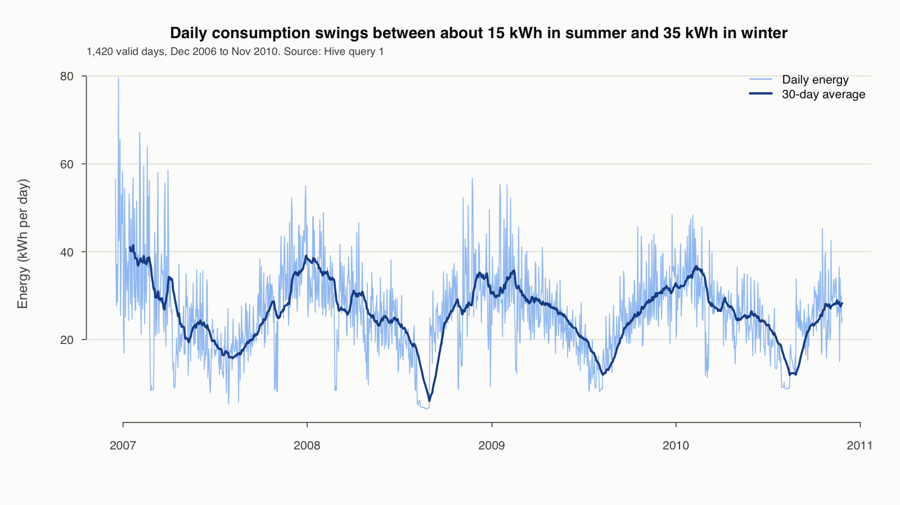
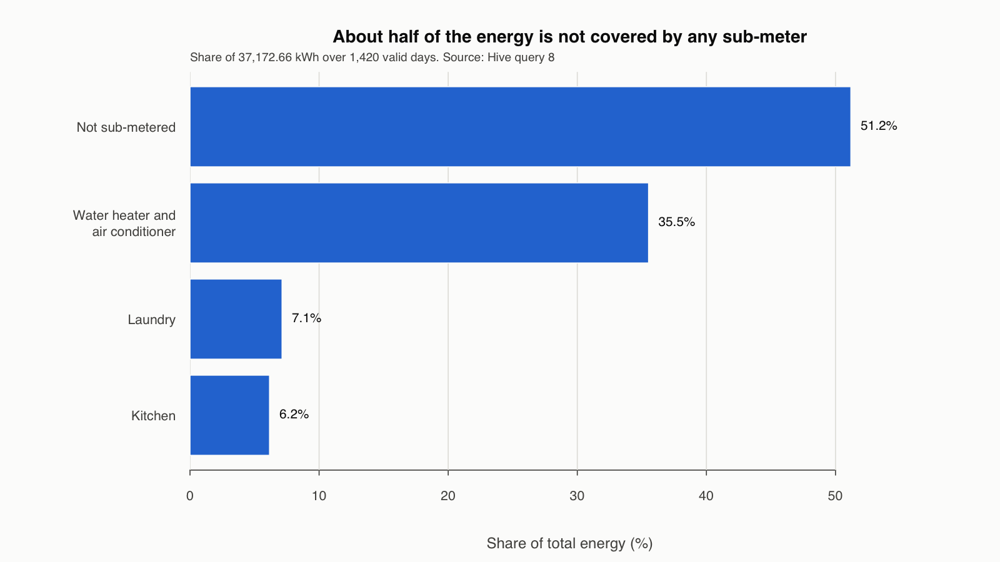
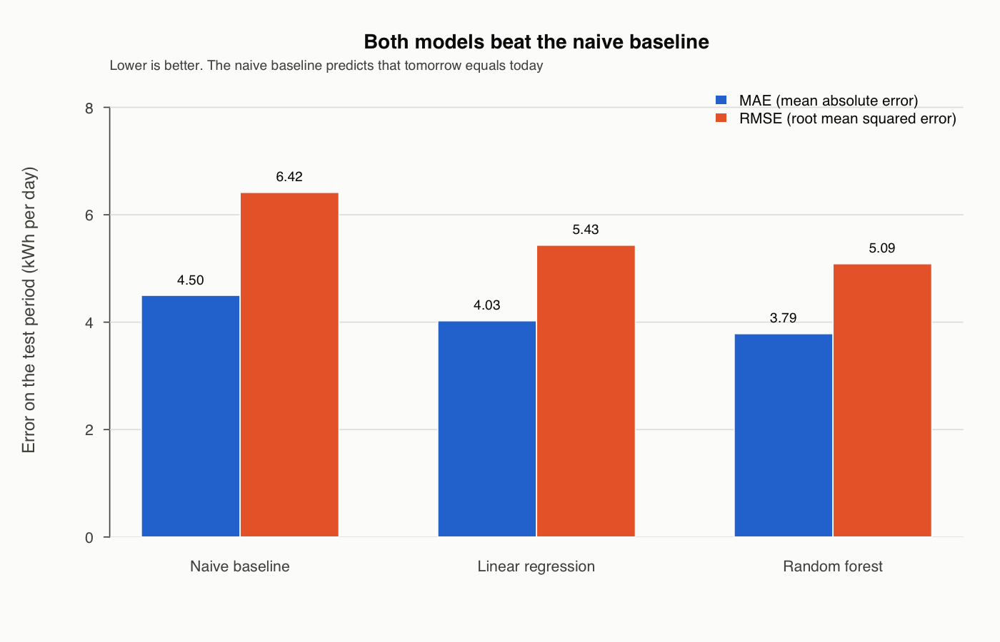
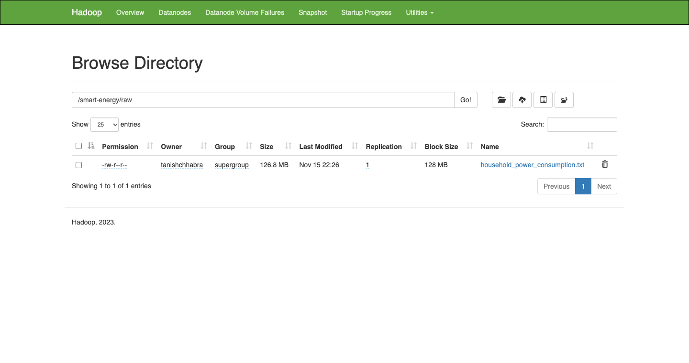
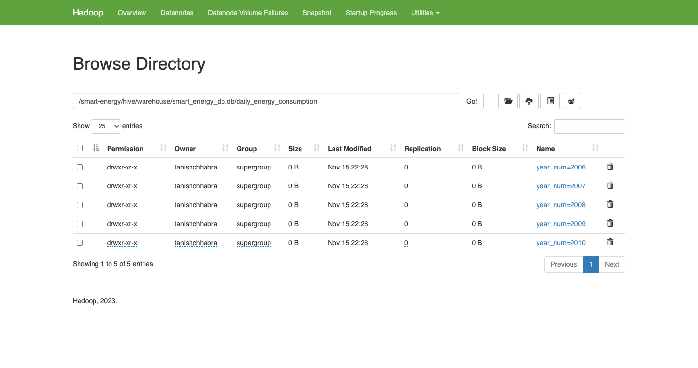
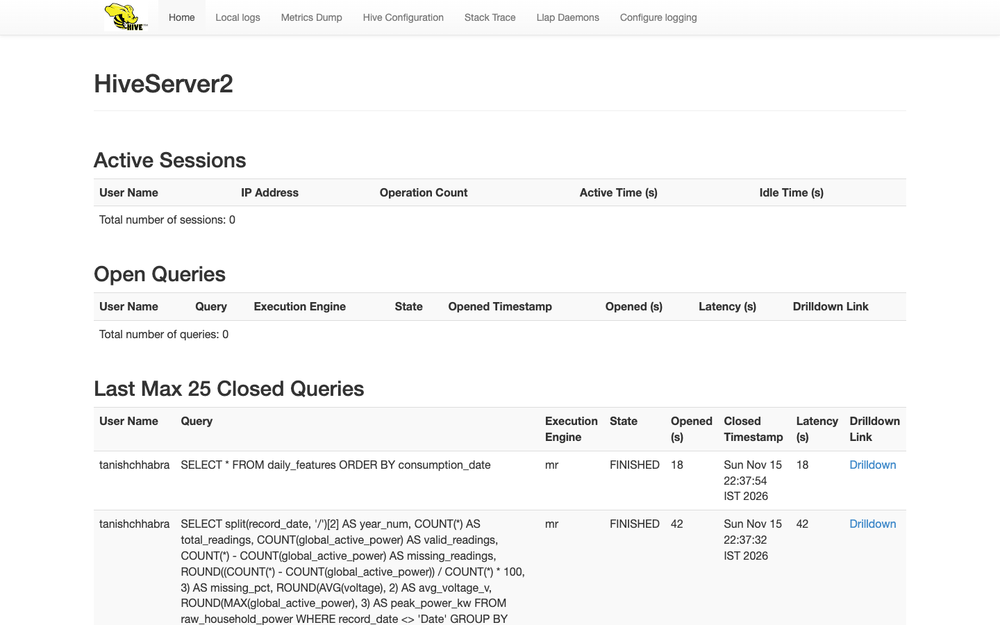

# Smart Energy Analytics: Household Electricity Consumption Analysis and Demand Forecasting

Course project for **Principles of Big Data Management (CSE 465)**.

| | |
|---|---|
| **Batch** | 30 |
| **Team** | Vaibhav (AP23110010425), Saubhagya Kashyap (AP23110010439) |
| **Data analysis** | Hadoop HDFS, Hadoop MapReduce (YARN), Apache Hive |
| **Data visualization and modelling** | R |
| **Dataset** | UCI Individual Household Electric Power Consumption: 2,075,259 one-minute readings, 2006 to 2010 |
| **Report** | [docs/report.pdf](docs/report.pdf) ([Markdown](docs/report.md)) |

The project stores four years of smart-meter readings in HDFS, aggregates them with two MapReduce jobs on YARN, preprocesses and queries them in Hive, and forecasts and visualizes the results in R.

## Pipeline

```
UCI raw file (2,075,259 rows)
        │
        ▼
HDFS  /smart-energy/raw  ───────────────────────────────┐
        │                                               │
        ▼                                               ▼
Hadoop MapReduce on YARN                        Apache Hive (HiveServer2)
  job 1: daily energy totals                      external table over the raw file
  job 2: hour-of-day load profile                 preprocessing → daily (ORC), hourly (Parquet)
        │                                         12 analysis queries
        │                                         feature table (window functions)
        │                                               │
        └──────────────────────┬────────────────────────┘
                               ▼
                               R
                 forecasting models (lm, randomForest)
                 12 graphs
```

| Stage | Tool | Code | Output |
|---|---|---|---|
| Storage | HDFS (single node) | `run_on_mac.sh` | `/smart-energy/...` in HDFS |
| Daily energy totals | Hadoop MapReduce on YARN | `hadoop/mapper.py`, `hadoop/reducer.py` | `hadoop/mapreduce_yarn_daily_output.txt` |
| Hour-of-day load profile | Hadoop MapReduce on YARN | `hadoop/mapper_hourly.py`, `hadoop/reducer_hourly.py` | `hadoop/mapreduce_yarn_hourly_output.txt` |
| Preprocessing | Apache Hive | `hive/schema.hql`, `hive/build_tables.hql` | Hive tables (ORC, Parquet) |
| Analysis | Apache Hive | `hive/queries.hql` (12 queries) | `hive/cluster_results/q01.csv` … `q12.csv` |
| Feature engineering | Apache Hive (window functions) | `hive/features.hql` | `hive/cluster_results/daily_features.csv` |
| Forecasting | R | `r/forecast_models.R` | `r/output/` |
| Visualization | R | `r/visualize.R` | `graphs/` (12 PNG files) |

## Key findings

- **Evening peak:** demand is highest at 20:00 (1.90 kW) and lowest at 04:00 (0.44 kW), a ratio of 4.3 to 1.
- **Weekends:** 19.1% more energy than weekdays (29.59 against 24.84 kWh a day).
- **Seasons:** an average December day uses 35.6 kWh, an average August day 13.7 kWh.
- **Appliances:** water heater and air conditioner 35.5%, laundry 7.1%, kitchen 6.2%, not sub-metered 51.2%.
- **Forecast:** a random forest predicts next-day consumption with a mean absolute error of 3.79 kWh, against 4.50 kWh for the naive baseline (R² 0.50).

## Graphs (drawn in R)










All twelve graphs are in [graphs/](graphs/).

## The cluster, running

HDFS holding the project data:


The full dataset in HDFS (126.8 MB):



MapReduce and Hive jobs on YARN:


The Hive daily table, stored as ORC with one partition per year:



HiveServer2:



## How to run (macOS)

You need a Mac with 8 GB of RAM, about 5 GB of free disk space, `python3` and Homebrew (for R). No sudo is needed.

```bash
bash run_on_mac.sh            # install and run everything
bash run_on_mac.sh hive       # run only the Hive stage
bash run_on_mac.sh r          # run only the R stage (models and graphs)
bash run_on_mac.sh test       # run only the tests
bash run_on_mac.sh status     # running daemons and HDFS contents
bash run_on_mac.sh stop       # stop HiveServer2 and Hadoop
```

The script installs Java 11, Hadoop 3.3.6 and Hive 4.0.1 into `~/bigdata`, downloads the dataset, starts a single-node cluster, and runs every stage. The first run takes 30 to 45 minutes, mostly downloads; later runs take about 15 minutes, of which Hive is about 12.

| Page | Address |
|---|---|
| HDFS NameNode | http://localhost:9870 |
| YARN ResourceManager | http://localhost:8088 |
| HiveServer2 | http://localhost:10002 |

To use the tools by hand:

```bash
export JAVA_HOME=$(ls -d ~/bigdata/jdk-11*/Contents/Home)
export HADOOP_HOME=~/bigdata/hadoop-3.3.6
export HIVE_HOME=~/bigdata/apache-hive-4.0.1-bin
export PATH=$JAVA_HOME/bin:$HADOOP_HOME/bin:$HIVE_HOME/bin:$PATH

hdfs dfs -ls -R /smart-energy
beeline -u jdbc:hive2://localhost:10000/smart_energy_db -n $USER
Rscript r/visualize.R
```

To remove everything the script installed: `bash run_on_mac.sh stop && rm -rf ~/bigdata`.

## Dataset

The dataset is the *Individual Household Electric Power Consumption* dataset from the UCI Machine Learning Repository: https://archive.ics.uci.edu/dataset/235

The full file (`data/raw/household_power_consumption.txt`, 126.8 MB) is not stored in git; `run_on_mac.sh` downloads it. A 5,000-row sample is in `data/raw/sample_household_power_consumption.txt`.

## Folder structure

```
├── run_on_mac.sh              one-command setup and run
├── hadoop/                    MapReduce mappers and reducers, job outputs and logs from YARN
├── hive/                      schema, preprocessing, queries, features, runner, results
├── r/                         forecasting and visualization scripts, model results
├── graphs/                    12 graphs drawn in R
├── screenshots/               HDFS, YARN and Hive web pages of the running cluster
├── data/raw/                  dataset (sample in git, full file downloaded)
├── docs/                      report (PDF and Markdown), viva questions
└── tests/                     18 automated tests
```

## Tests

18 tests check the mappers and reducers, and cross-check the cluster outputs: MapReduce against Hive, Hive against the raw row counts, the features for leakage, and the R models against the naive baseline.

```bash
bash run_on_mac.sh test
```

## Limitations

- The dataset is 126.8 MB, which fits in one HDFS block, and the cluster has one node. The project shows the workflow of a Hadoop cluster, not its scale.
- Hive uses the MapReduce engine, so each query takes 20 seconds to 2 minutes.
- The data describes one household in France and has no weather readings.

## Licence

MIT; see [LICENSE](LICENSE).
