# Smart Energy Analytics: Household Electricity Consumption Analysis and Demand Forecasting

**Course project: Principles of Big Data Management (CSE 465)**

| | |
|---|---|
| **Batch** | 30 |
| **Team** | Vaibhav (AP23110010425), Saubhagya Kashyap (AP23110010439) |
| **Data analysis** | Hadoop HDFS, Hadoop MapReduce (YARN), Apache Hive |
| **Data visualization and modelling** | R |
| **Dataset** | UCI Individual Household Electric Power Consumption (2,075,259 rows) |
| **Code** | https://github.com/vaibhavv-x/Smart-Energy-Analytics- |

---

## 1. Abstract

Smart meters record a household's electricity use every minute. Four years of such readings for one home come to more than two million rows, which is enough to show when the home uses power, what uses it, and how use changes with the day of the week and the season. This project analyses the UCI Individual Household Electric Power Consumption dataset (2,075,259 one-minute readings, December 2006 to November 2010) with the Hadoop ecosystem and R.

The raw file is stored in HDFS on a single-node Hadoop cluster. Two Hadoop MapReduce jobs on YARN compute the daily energy totals and the hour-of-day load profile. Apache Hive does the preprocessing (unit conversion, removal of missing readings, daily and hourly aggregation), stores the results in ORC and Parquet tables, answers twelve analysis queries, and builds a leak-free feature table with window functions. R reads the Hive results, trains two models that forecast the next day's consumption, and draws all the graphs.

The main findings are: demand peaks at 20:00 and is lowest at 04:00, a ratio of 4.3 to 1; weekends use 19.1% more energy than weekdays; an average December day uses 2.6 times as much as an August day; the evening carries 35% of the energy; and a random forest predicts next-day consumption with a mean absolute error of 3.79 kWh, against 4.50 kWh for a naive baseline.

## 2. Introduction

Electricity cannot be stored cheaply, so a grid must generate what is being used at each moment. The expensive hours are the peaks: a utility has to keep enough plant available for the highest demand of the year even though that demand lasts a few hours. Anything that moves household demand away from the evening peak, or that lets a utility predict tomorrow's demand, lowers cost and waste. This is the subject of United Nations Sustainable Development Goal 7 (affordable and clean energy), in particular its target on energy efficiency.

Smart meters make this possible by measuring use every minute instead of once a month. The price is volume: one home produces about half a million readings a year, and a city of homes produces billions. That is a data management problem before it is an analysis problem, and it is the kind of problem the Hadoop ecosystem was built for: store the raw data once in a distributed file system, and run batch jobs and SQL queries over it in parallel.

This project applies that approach to a real public smart-meter dataset. The objectives are:

1. Store the raw readings in HDFS and process them with Hadoop MapReduce.
2. Preprocess the data and answer analysis questions with Apache Hive.
3. Build forecasting features in Hive and forecast next-day consumption in R.
4. Visualize every result in R.

The questions the analysis answers are: at what hours does the household use the most power; how do weekdays and weekends, and summer and winter, differ; which appliances account for the energy; how complete is the raw data; and how well can tomorrow's consumption be predicted from the recent past.

## 3. Problem Survey

**Short-term load forecasting.** Forecasting electricity demand a day ahead is an established field; Hong and Fan [6] review it and note that forecasts for a single household are much harder than forecasts for a region, because one family's behaviour does not average out. Kong et al. [7] show this for individual homes and use recurrent neural networks to model it. Kim and Cho [8] apply a combined convolutional and recurrent network to the same UCI dataset that this project uses. These studies concentrate on model accuracy and run on a single machine with the data already cleaned.

**Simple baselines.** Hyndman and Athanasopoulos [9] recommend that every forecasting method be compared with a naive forecast that repeats the last observed value. A method that cannot beat this baseline has learned nothing useful. Many student projects omit the comparison; this project reports it for every model.

**Random forests.** Breiman's random forest [5] averages many decision trees trained on random subsets of the data and of the features. It captures non-linear effects, such as weekend behaviour differing by season, needs little tuning, and reports how important each feature is.

**Big data processing.** Dean and Ghemawat [2] introduced MapReduce, which expresses a batch computation as a map step that emits key-value pairs and a reduce step that combines the values of each key, so that the framework can run both in parallel. The Hadoop Distributed File System [3] stores the input as large blocks across machines. Hive [4] adds a SQL layer: tables are files in HDFS, and queries are compiled into MapReduce jobs.

**Gap addressed.** The forecasting literature usually starts from a cleaned table and says little about how the raw readings are stored and processed. This project covers the whole path on the Hadoop ecosystem: raw file in HDFS, aggregation with MapReduce, preprocessing and feature engineering in Hive, and modelling and visualization in R, with each stage checked against another.

## 4. Dataset Description and Preprocessing

### 4.1 Dataset

| Property | Value |
|---|---|
| Name | Individual Household Electric Power Consumption [1] |
| Source | UCI Machine Learning Repository (collected by EDF R&D, France) |
| Coverage | One household in Sceaux, near Paris; 16 December 2006 to 26 November 2010 |
| Size | 2,075,259 rows, one per minute; 126.8 MB as text |
| Format | Text, fields separated by `;`, missing values written as `?` |

| Column | Meaning | Unit |
|---|---|---|
| `Date`, `Time` | Timestamp of the reading | d/m/yyyy, hh:mm:ss |
| `Global_active_power` | Power used by the household, averaged over the minute | kW |
| `Global_reactive_power` | Reactive power | kW |
| `Voltage` | Voltage | V |
| `Global_intensity` | Current | A |
| `Sub_metering_1` | Kitchen (dishwasher, oven, microwave) | Wh |
| `Sub_metering_2` | Laundry room (washing machine, dryer, refrigerator) | Wh |
| `Sub_metering_3` | Water heater and air conditioner | Wh |

### 4.2 Data quality

Hive query 12 counts the readings directly on the raw table. Of 2,075,259 readings, 25,979 (1.25%) are missing. Missing readings are below 1% in every year except 2010 (3.7%).

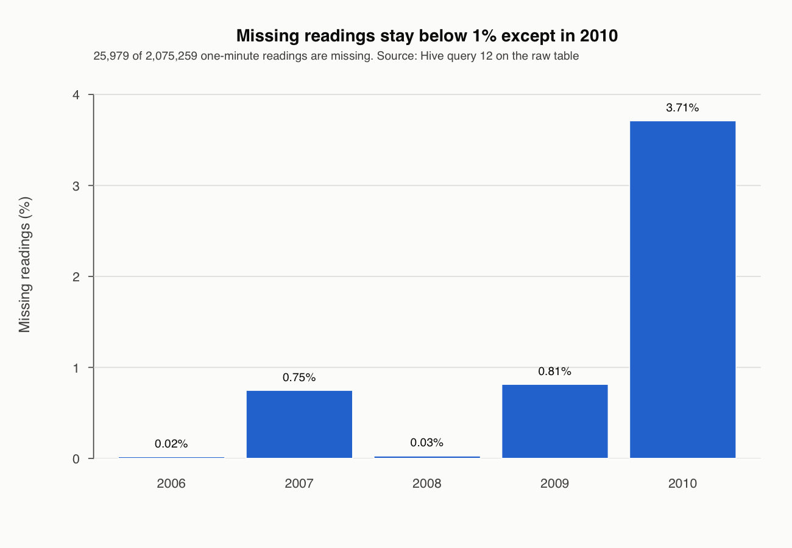

### 4.3 Preprocessing (in Hive)

All preprocessing is done in HiveQL (`hive/build_tables.hql`) and runs as MapReduce jobs on YARN over the raw table:

1. **Missing readings are dropped, not filled in.** Inventing values for a missing minute would add energy that was never measured.
2. **Power to energy.** A one-minute reading of P kW represents P ÷ 60 kWh.
3. **Sub-meters to kWh.** Watt-hours ÷ 1000.
4. **Unmetered remainder.** Energy not covered by the three sub-meters, never below zero.
5. **Aggregation.** A daily table (1,433 days) and an hourly table (34,168 hours).
6. **Valid days.** A day is valid when at least 85% of its 1,440 readings are present. 1,420 days are valid; the other 13 are excluded from the analysis.
7. **Calendar columns.** Day of week, weekend flag, month and year.

The daily table is stored as ORC and partitioned by year; the hourly table is stored as Parquet.

## 5. Implementation

### 5.1 Architecture

```
UCI raw file (2,075,259 rows)
        │
        ▼
HDFS  /smart-energy/raw  ───────────────────────────────┐
        │                                               │
        ▼                                               ▼
Hadoop MapReduce on YARN                        Apache Hive (HiveServer2)
  job 1: daily energy totals                      external table over the raw file
  job 2: hour-of-day load profile                 preprocessing → daily (ORC), hourly (Parquet)
        │                                         12 analysis queries
        │                                         feature table (window functions)
        │                                               │
        └──────────────────────┬────────────────────────┘
                               ▼
                               R
                 forecasting models (lm, randomForest)
                 12 graphs
```

The cluster is a single node (Apple M1, 8 GB RAM) running Hadoop 3.3.6 and Hive 4.0.1 on Java 11, with R 4. One script, `run_on_mac.sh`, installs and runs every stage.

| Stage | Tool | Files |
|---|---|---|
| Storage | HDFS | `/smart-energy/raw`, `/mapreduce`, `/hive/warehouse` |
| Batch aggregation | Hadoop MapReduce (Streaming) on YARN | `hadoop/mapper*.py`, `hadoop/reducer*.py` |
| Preprocessing, queries, features | Apache Hive | `hive/schema.hql`, `build_tables.hql`, `queries.hql`, `features.hql` |
| Forecasting | R (`lm`, `randomForest`) | `r/forecast_models.R` |
| Visualization | R (base graphics) | `r/visualize.R` |

The cluster holding the data and the finished jobs:

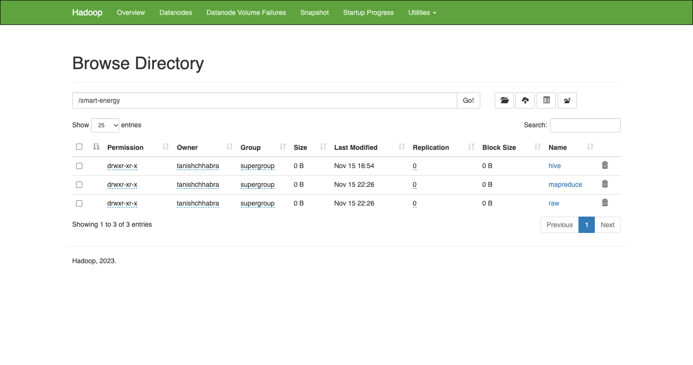

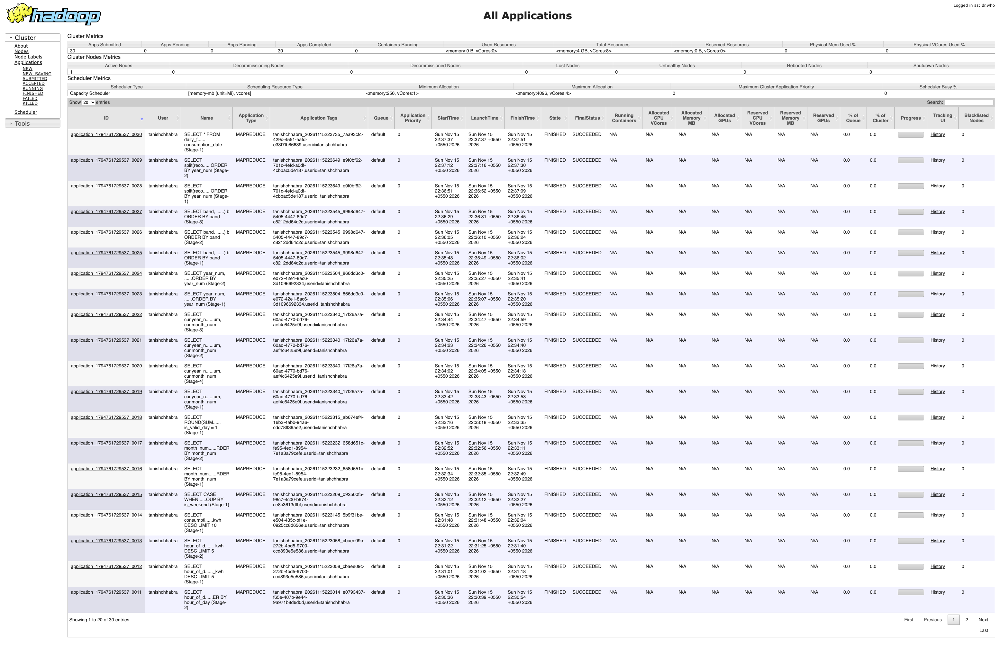

### 5.2 Hadoop MapReduce

Both jobs are Hadoop Streaming jobs: Hadoop splits the file in HDFS, feeds the lines to the mapper, sorts the mapper's output by key, and feeds it to the reducer. Each job read all 2,075,259 rows with two map tasks and one reduce task.

**Job 2 mapper** (`hadoop/mapper_hourly.py`): emits the hour as the key, with the energy and the power of the reading.

```python
for line in sys.stdin:
    line = line.strip()
    if not line or line.startswith("Date;"):
        continue                                  # skip the header
    parts = line.split(";")
    time_str, power_str = parts[1].strip(), parts[2].strip()
    if power_str in ("?", ""):
        continue                                  # skip missing readings
    hour = time_str[:2]
    power_kw = float(power_str)
    print(f"{hour}\t{power_kw / 60.0:.6f}\t{power_kw:.3f}")   # hour, kWh, kW
```

**Job 2 reducer** (`hadoop/reducer_hourly.py`): the input arrives sorted by hour, so the reducer keeps running totals and emits one line each time the hour changes.

```python
for line in sys.stdin:
    hour, kwh, kw = line.strip().split("\t")
    if hour != current:
        if current is not None:
            emit(current, energy, count, peak)    # total kWh, readings, average kW, peak kW
        current, energy, count, peak = hour, 0.0, 0, 0.0
    energy += float(kwh)
    count += 1
    peak = max(peak, float(kw))
```

Job 1 (`mapper.py`, `reducer.py`) has the same structure with the date as the key and returns the total energy and the number of readings for each of the 1,433 days.

**Submitting a job** (from `run_on_mac.sh`):

```bash
hadoop jar hadoop-streaming-3.3.6.jar \
  -D mapreduce.job.name="smart-energy-hourly-profile" \
  -files mapper_hourly.py,reducer_hourly.py \
  -mapper "python3 mapper_hourly.py" -reducer "python3 reducer_hourly.py" \
  -input /smart-energy/raw/household_power_consumption.txt \
  -output /smart-energy/mapreduce/hourly_profile
```

### 5.3 Apache Hive

**Raw table** (`hive/schema.hql`): an external table over the file already in HDFS, so no data is copied.

```sql
CREATE EXTERNAL TABLE raw_household_power (
    record_date STRING, record_time STRING,
    global_active_power DOUBLE, global_reactive_power DOUBLE,
    voltage DOUBLE, global_intensity DOUBLE,
    sub_metering_1 DOUBLE, sub_metering_2 DOUBLE, sub_metering_3 DOUBLE
)
ROW FORMAT DELIMITED FIELDS TERMINATED BY ';'
STORED AS TEXTFILE
LOCATION '/smart-energy/raw'
TBLPROPERTIES ("serialization.null.format"="?");
```

**Preprocessing** (`hive/build_tables.hql`, shortened): the daily table is built from the raw table and written into one partition per year.

```sql
INSERT OVERWRITE TABLE daily_energy_consumption PARTITION (year_num)
SELECT d, total_energy_kwh, ..., reading_count / 1440.0,
       CASE WHEN reading_count >= 1224 THEN 1 ELSE 0 END,      -- valid day
       date_format(d, 'EEEE'),
       CASE WHEN dayofweek(d) IN (1, 7) THEN 1 ELSE 0 END,     -- weekend
       month(d), date_format(d, 'MMMM'), year(d)
FROM (
    SELECT d, SUM(kwh) AS total_energy_kwh, ..., CAST(COUNT(*) AS INT) AS reading_count
    FROM (
        SELECT concat(split(record_date,'/')[2], '-', lpad(split(record_date,'/')[1],2,'0'), '-',
                      lpad(split(record_date,'/')[0],2,'0')) AS d,
               global_active_power / 60.0 AS kwh, ...
        FROM raw_household_power
        WHERE record_date <> 'Date' AND global_active_power IS NOT NULL
    ) readings
    GROUP BY d
) days;
```

**Analysis queries** (`hive/queries.hql`): twelve queries. For example, query 11 splits the energy by time of day:

```sql
SELECT band, ROUND(total_kwh, 2) AS total_kwh,
       ROUND(total_kwh / SUM(total_kwh) OVER () * 100, 2) AS share_pct
FROM (
    SELECT band, SUM(total_energy_kwh) AS total_kwh
    FROM (
        SELECT CASE WHEN hour_of_day < 6  THEN '1 Night (00-05)'
                    WHEN hour_of_day < 12 THEN '2 Morning (06-11)'
                    WHEN hour_of_day < 18 THEN '3 Afternoon (12-17)'
                    ELSE '4 Evening (18-23)' END AS band,
               total_energy_kwh
        FROM hourly_energy_consumption
    ) h
    GROUP BY band
) b
ORDER BY band;
```

| Query | Question | Rows |
|---|---|---|
| Q1 | Daily consumption over time | 1,420 |
| Q2 | Monthly totals and averages per year | 48 |
| Q3 | Average consumption in each hour of the day | 24 |
| Q4 | Five busiest hours | 5 |
| Q5 | Ten highest-consumption days | 10 |
| Q6 | Weekday against weekend | 2 |
| Q7 | Average day in each calendar month | 12 |
| Q8 | Share of each sub-meter | 1 |
| Q9 | Change in each month against the same month a year earlier | 36 |
| Q10 | Share of days above 40 kWh, per year | 5 |
| Q11 | Share of energy by time-of-day band | 4 |
| Q12 | Valid and missing readings per year, on the raw table | 5 |

Hive runs each query as one or more MapReduce jobs on YARN; a query took between 22 and 84 seconds.

**Feature engineering** (`hive/features.hql`, shortened): window functions build the inputs for forecasting. Every window ends on the previous day, so no feature contains information from the day being predicted.

```sql
CREATE TABLE daily_features STORED AS ORC AS
SELECT * FROM (
    SELECT consumption_date, total_energy_kwh AS energy_kwh,
           LAG(total_energy_kwh, 1) OVER (ORDER BY consumption_date) AS lag_1_energy_kwh,
           LAG(total_energy_kwh, 7) OVER (ORDER BY consumption_date) AS lag_7_energy_kwh,
           AVG(total_energy_kwh) OVER (ORDER BY consumption_date
               ROWS BETWEEN 7 PRECEDING AND 1 PRECEDING) AS rolling_mean_7_kwh,
           STDDEV_SAMP(total_energy_kwh) OVER (ORDER BY consumption_date
               ROWS BETWEEN 7 PRECEDING AND 1 PRECEDING) AS rolling_std_7_kwh,
           ...
    FROM daily_energy_consumption
    WHERE is_valid_day = 1
) f
WHERE lag_7_energy_kwh IS NOT NULL;
```

The table has 1,413 days and 15 features: consumption 1, 2 and 7 days earlier; the mean and standard deviation of the previous 7 days and the mean of the previous 14; the previous day's average power, peak power, voltage and three sub-meter totals; and day of week, weekend flag and month.

The daily table in the Hive warehouse, one folder per year:

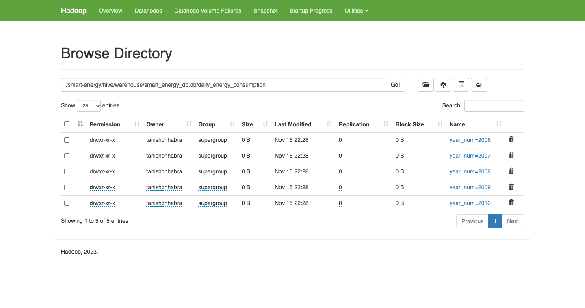

### 5.4 Forecasting in R

`r/forecast_models.R` reads the feature table exported from Hive. The data is split by time and never shuffled: the first 989 days train the models, the next 211 are used to choose between them, and the last 213 (19 April to 26 November 2010) test the chosen model.

```r
train <- df[1:n_train, ]
val   <- df[(n_train + 1):(n_train + n_val), ]
test  <- df[(n_train + n_val + 1):n, ]

lm_fit <- lm(model_formula, data = train)

set.seed(42)
rf_fit <- randomForest(model_formula, data = train, ntree = 300, nodesize = 5, importance = TRUE)

metrics <- function(actual, predicted) {
  err <- actual - predicted
  c(MAE = mean(abs(err)), RMSE = sqrt(mean(err^2)),
    R2 = 1 - sum(err^2) / sum((actual - mean(actual))^2),
    MAPE = mean(abs(err / actual)) * 100)
}
```

Three forecasts are compared: a naive baseline that predicts yesterday's value, linear regression, and a random forest of 300 trees.

### 5.5 Visualization in R

`r/visualize.R` reads the Hive query results and the MapReduce output and draws twelve graphs. For example, the hour-of-day chart:

```r
h <- read.delim("hadoop/mapreduce_yarn_hourly_output.txt", header = FALSE,
                col.names = c("hour", "kwh", "readings", "avg_kw", "peak_kw"))
png("graphs/02_hourly_load_profile.png", width = 1600, height = 900, res = 160)
barplot(h$avg_kw, names.arg = sprintf("%02d", h$hour), col = "#2a78d6",
        ylab = "Average power (kW)", main = "Demand peaks at 20:00 and is lowest at 04:00")
dev.off()
```

### 5.6 Verification

The same quantities are computed by independent tools and compared by 18 automated tests:

- The daily totals from MapReduce job 1 equal the daily energy in Hive on all 1,420 valid days (difference below 0.001 kWh), with the same reading counts.
- The hourly averages from MapReduce job 2 equal those from Hive query 3.
- Hive's counts on the raw table add up to 2,075,259 readings, of which 25,979 are missing.
- Every lag and rolling feature is recomputed from earlier days only and matches the Hive table.
- Both R models beat the naive baseline.

## 6. Resultant Graphs

All graphs are drawn in R from the Hive and MapReduce results.

### 6.1 Daily consumption

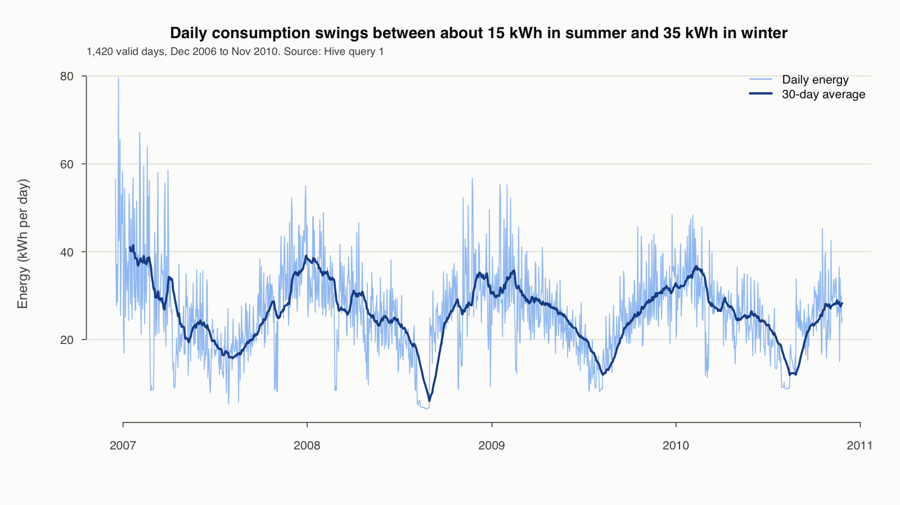

Consumption follows the seasons: about 35 kWh a day in winter and about 15 kWh in summer. The dips each August are holidays, when the house uses under 10 kWh a day.

### 6.2 Hour-of-day load profile (MapReduce job 2)

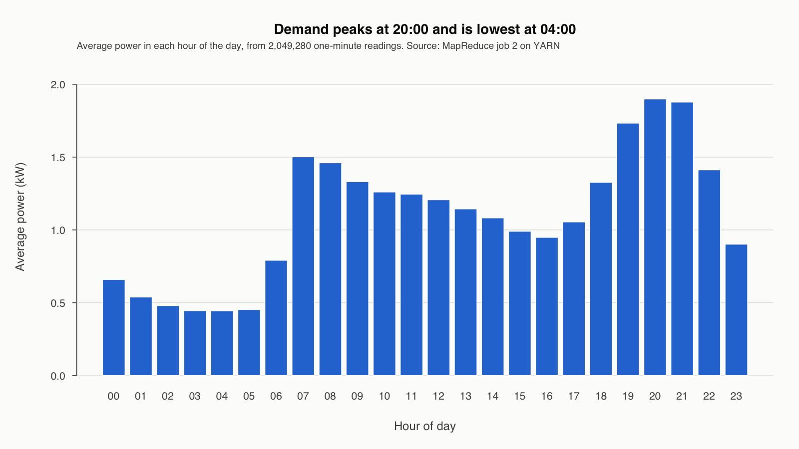

Demand is lowest at 04:00 (0.44 kW), rises to a morning peak at 07:00 to 08:00, and reaches its maximum at 20:00 (1.90 kW). The busiest hour uses 4.3 times as much as the quietest.

### 6.3 Seasonal pattern

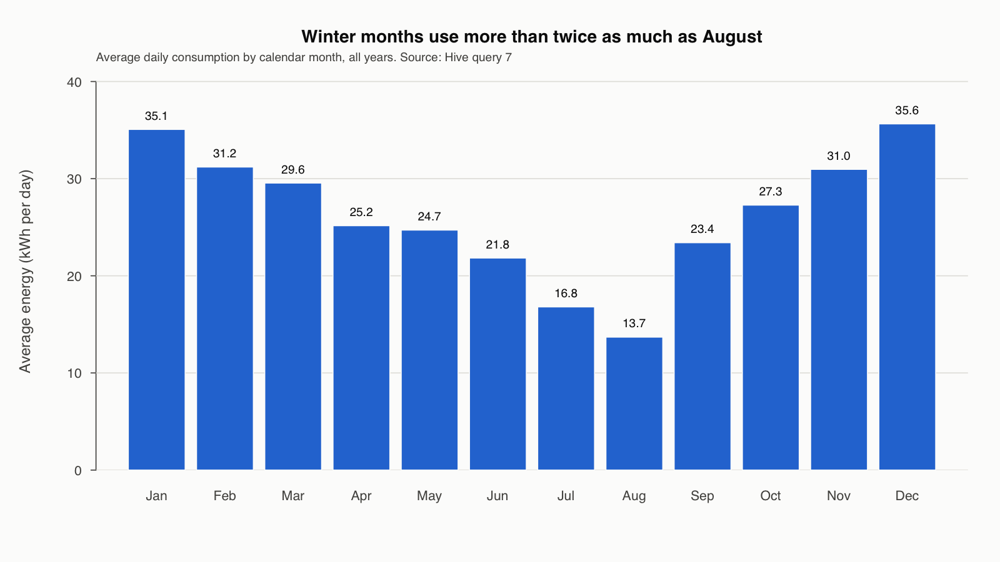

December (35.6 kWh a day) and January (35.1) are the highest months; August (13.7) and July (16.8) are the lowest. An average December day uses 2.6 times as much as an average August day.

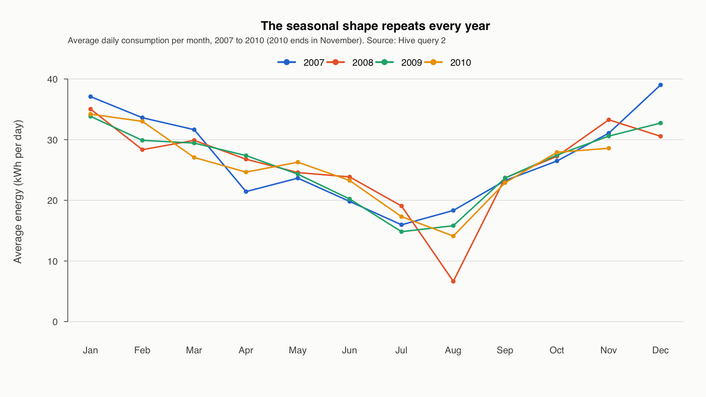

The same shape repeats in each of the four full years.

### 6.4 Weekdays and weekends

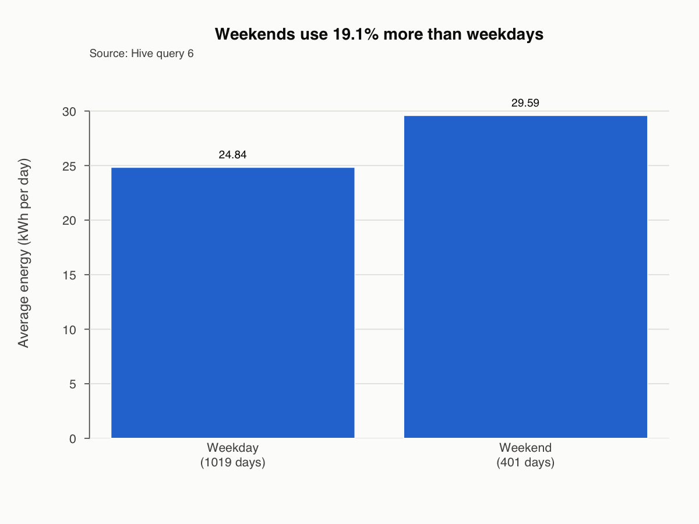

Weekend days average 29.59 kWh and weekdays 24.84 kWh: the household uses 19.1% more when it is at home.

### 6.5 What uses the energy

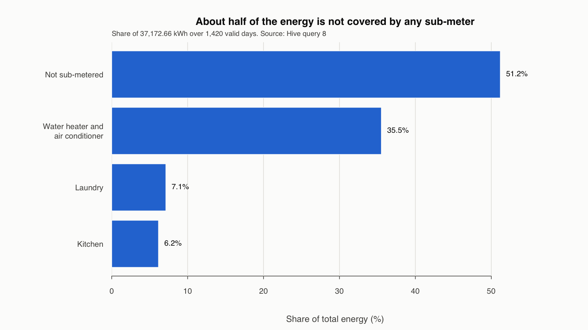

The water heater and air conditioner are the largest metered load at 35.5%. Laundry (7.1%) and the kitchen (6.2%) are small. About half of the energy (51.2%) is used by appliances that no sub-meter covers, such as lighting and electronics.

### 6.6 Time of day

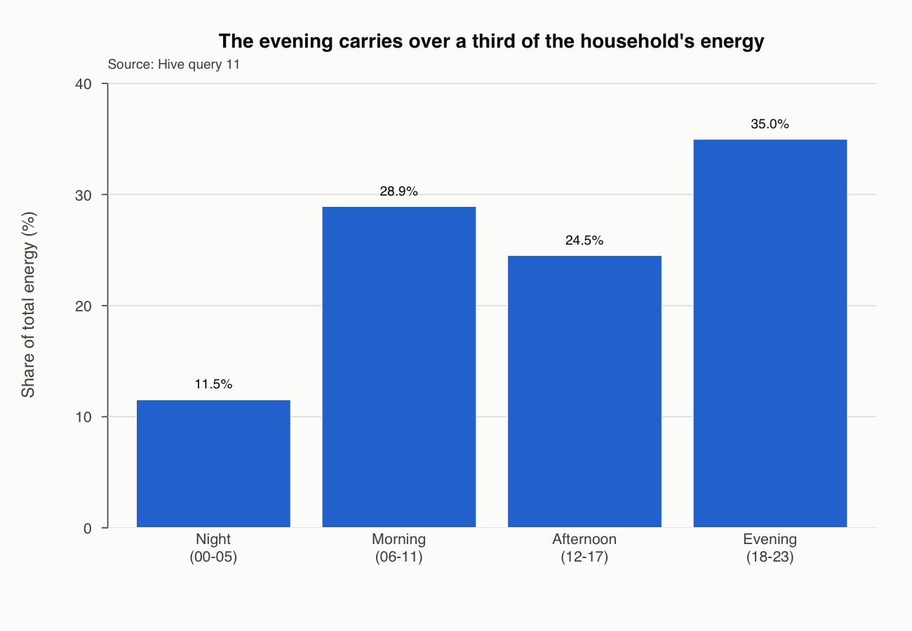

The evening (18:00 to 23:59) carries 35.0% of the energy and the night only 11.5%.

### 6.7 Heavy-consumption days

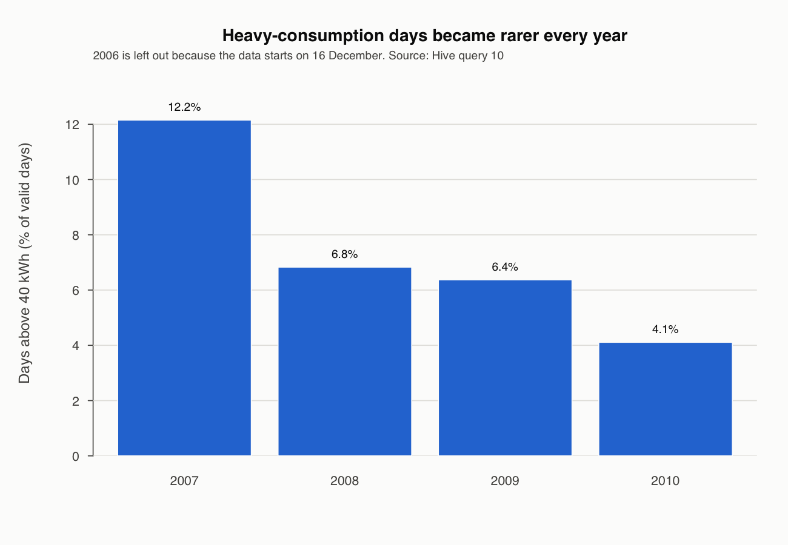

Days above 40 kWh fell from 12.2% of days in 2007 to 4.1% in 2010.

### 6.8 Forecasting

| Model | MAE (kWh) | RMSE (kWh) | R² | MAPE |
|---|---|---|---|---|
| Naive baseline | 4.50 | 6.42 | 0.20 | 19.2% |
| Linear regression | 4.03 | 5.43 | 0.43 | 18.7% |
| Random forest (selected) | 3.79 | 5.09 | 0.50 | 18.0% |

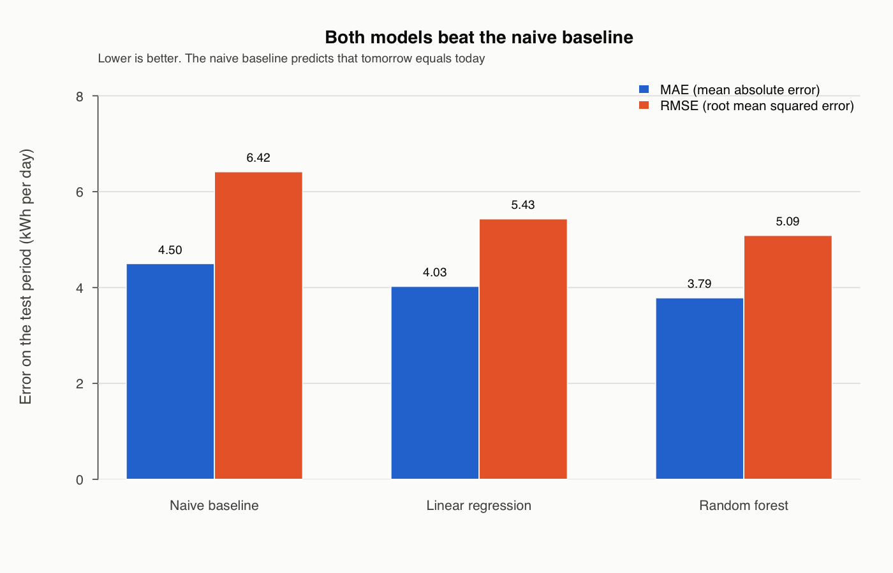

Both models beat the naive baseline. The random forest has the lowest validation error and is selected; on the test period it reduces the root mean squared error by 20.7% and the mean absolute error by 15.9% relative to the baseline.

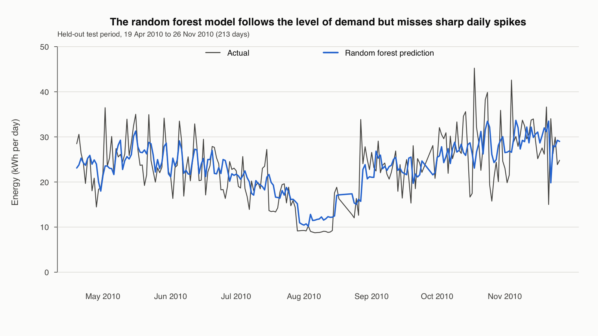

The forecast follows the level of demand, including the August holiday, but does not anticipate single-day spikes.

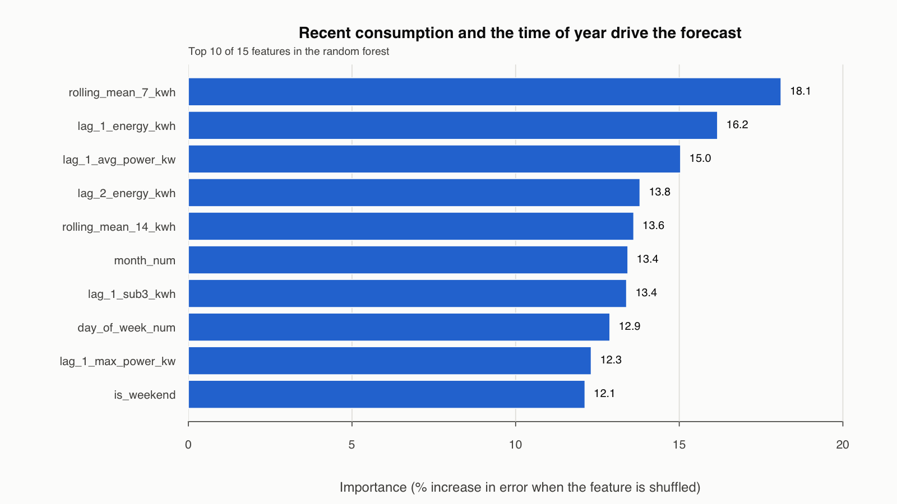

The most useful inputs are the average of the previous seven days and the previous day's consumption.

## 7. Conclusion

The project ran a complete analysis of a real smart-meter dataset on the Hadoop ecosystem: the raw data in HDFS, two MapReduce jobs on YARN, preprocessing, twelve queries and feature engineering in Hive, and forecasting and visualization in R. The stages check each other: MapReduce and Hive compute the same daily and hourly figures from the same raw file.

The household's electricity use has a clear structure. It peaks in the evening and in winter, is 19.1% higher at weekends, and is dominated by water heating and air conditioning among the metered loads. For energy efficiency, this points to one practical action: moving water heating, laundry and dishwashing from the evening to the 01:00 to 05:00 valley would flatten the load curve. The dataset has no tariff information, so the report does not put a money value on that change.

Next-day consumption can be forecast better than the naive baseline: the random forest's error is 3.79 kWh a day against 4.50 kWh. It explains about half of the day-to-day variation (R² 0.50); the rest depends on things the data does not contain, such as the weather and whether the family is at home.

**Limitations.** The dataset is 126.8 MB, which fits in a single HDFS block, and the cluster has one node with replication factor 1; the project demonstrates the workflow of a Hadoop cluster, not its scale or fault tolerance. Hive runs on the MapReduce engine, so queries on small tables take 22 to 84 seconds. The data describes one household in France and has no weather readings.

**Future work.** Add temperature data to the features; forecast each hour of the next day; use Tez as the Hive engine; and repeat the analysis on a multi-household dataset large enough to need several HDFS blocks and nodes.

**Acknowledgement.** The first MapReduce job and Hive queries 1 to 8 are adapted from an open-source project released under the MIT licence (see `LICENSE`).

## References

1. G. Hébrail and A. Bérard. *Individual Household Electric Power Consumption*. UCI Machine Learning Repository, 2012. https://archive.ics.uci.edu/dataset/235/individual+household+electric+power+consumption
2. J. Dean and S. Ghemawat. "MapReduce: Simplified Data Processing on Large Clusters." *OSDI*, 2004.
3. K. Shvachko, H. Kuang, S. Radia and R. Chansler. "The Hadoop Distributed File System." *IEEE MSST*, 2010.
4. A. Thusoo et al. "Hive: A Warehousing Solution over a Map-Reduce Framework." *Proceedings of the VLDB Endowment*, 2(2), 2009.
5. L. Breiman. "Random Forests." *Machine Learning*, 45(1), 2001.
6. T. Hong and S. Fan. "Probabilistic Electric Load Forecasting: A Tutorial Review." *International Journal of Forecasting*, 32(3), 2016.
7. W. Kong, Z. Y. Dong, Y. Jia, D. J. Hill, Y. Xu and Y. Zhang. "Short-Term Residential Load Forecasting Based on LSTM Recurrent Neural Network." *IEEE Transactions on Smart Grid*, 10(1), 2019.
8. T.-Y. Kim and S.-B. Cho. "Predicting Residential Energy Consumption Using CNN-LSTM Neural Networks." *Energy*, 182, 2019.
9. R. J. Hyndman and G. Athanasopoulos. *Forecasting: Principles and Practice*. OTexts.
10. Apache Hadoop 3.3.6 and Apache Hive 4.0.1 documentation. https://hadoop.apache.org, https://hive.apache.org
